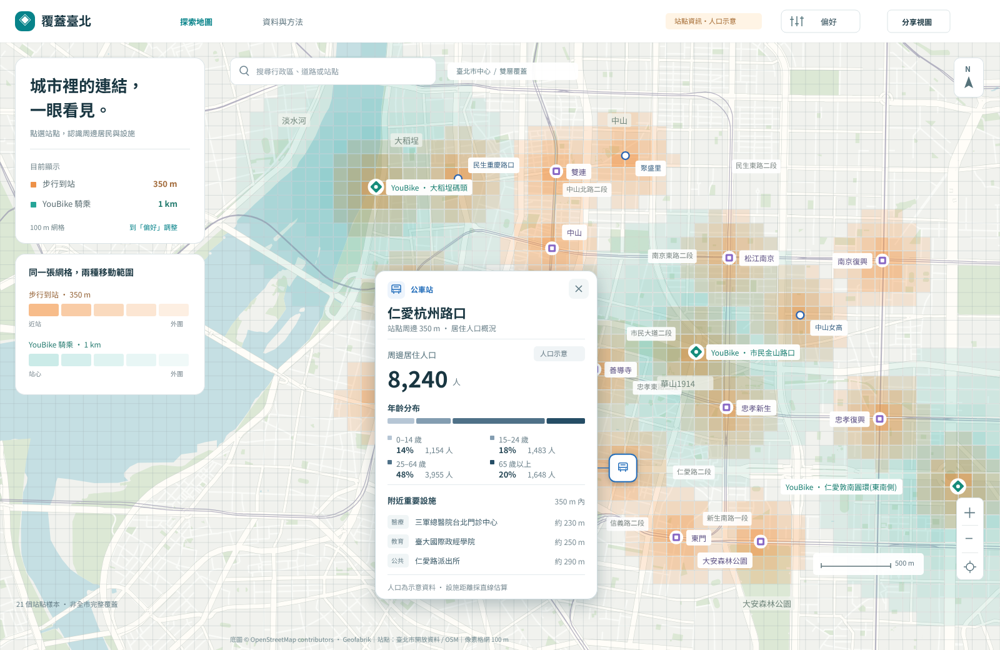

<picture>
  <source media="(prefers-color-scheme: dark)" srcset="branding/assets/png/logo-horizontal-reverse@2x.png">
  
</picture>

# Bus coming soon｜公車路網需求分析

讓公車路網回應城市裡持續變化的需求。我們以臺北市為起點，整合公共運輸、人口與重要設施的開放資料，打造 Web GIS，協助市府、客運業者、公車工會與民眾一起看懂：**哪裡已有服務、哪裡可能不足，以及調整路線可能影響誰。**

[開啟地圖](https://bus.tw.pe/) · [Penpot 設計稿](https://penpot.c3land.org/#/workspace?file-id=94a073f9-47a7-80c1-8008-d636bc5359e3&page-id=7a48f695-9549-80a2-8008-d647e862844e) · [啟動與使用](docs/web-map.md) · [品牌指南](branding/BCS-Brand-Guidelines.pdf)

上圖於 2026-10-24 自 Penpot 第 04 頁匯出，人口及年齡比例為示意；現行網站顯示戶籍人口估算，年齡分布仍顯示缺資料。設計稿與前端目前使用「覆蓋臺北」名稱，新品牌素材位於 [branding/](branding/)。

## 我們想解決的問題

通勤、就學、就醫、公共運輸轉乘與都市發展，都會改變一座城市對公車的需求。路線規劃同時受道路空間、車輛與駕駛人力、行駛時間、休息安排及營運成本限制；路線重疊，也不必然代表可以減班或撤線。

本專案希望把分散的資料放到同一張地圖上，先辨識服務覆蓋與需求落差，再逐步支援新增、刪除、編輯路線的方案比較。評估除了整體覆蓋增減，也要關注高齡者、學生及重要設施是否失去服務，並納入路線時長與營運可行性。這是一套可持續更新、可追溯依據的公共討論工具，讓不同任期與團隊都能沿用。

| 利害關係人 | 需要回答的問題 |
| --- | --- |
| 市府路網規劃人員 | 哪些區域需求較高、供給較少？調整方案會新增或減少哪些服務？ |
| 客運公司 | 路線、班次與轉乘如何配置？人力、車輛、路線時長與成本能否負擔？ |
| 公車工會與駕駛 | 路線調整是否增加工時壓力？折返點與休息安排是否足夠？ |
| 民眾與地方團體 | 住家、學校、醫院附近有哪些服務？調整後誰受益、誰可能受影響？ |

## 目前可用與下一步

目前 `web/` 已實作三種分析圖層、站點查詢與路線方案工具，詳細算法及限制見[前端地圖說明](docs/web-map.md)。

| 功能 | 目前狀態與範圍 |
| --- | --- |
| 公車班次網格 | 依日型、小時與網格大小呈現計畫發車供給；不是實際發車或載客量。 |
| 公共運輸覆蓋 | 公車、捷運、YouBike 站點的直線距離覆蓋；可從「偏好」調整各站種半徑、網格與標記，套用後生效。 |
| 需求落差 | 整合居住人口、重要地點、捷運活動與公車供給，支援時段切換及權重調整；屬研究指標，權重是假設值。 |
| 三種站點資訊卡 | 點站點或搜尋站名，查看固定直線 350 m 內的戶籍人口估算、戶數、重要設施與周邊交通；人口分析範圍獨立於覆蓋偏好。 |
| 地圖分享 | 將地圖位置與分析設定寫入網址，供其他人開啟相同視圖。 |
| 路線新增、刪除、編輯與影響比較 | 依 Penpot 04-01 提供站序／路徑／班次編輯、人口與設施影響預覽、本機保存及復原；屬假設試算，高齡及學生資料未接入，詳見[路線工具](docs/route-editor.md)。 |

資料以臺北市近三年為主，另有跨市路線、北北基人口與里界、道路速率／流量及站間旅時等補充來源。**資料已整理不代表已接入前端或完成分析驗收**，各自範圍見下方資料目錄。

站點人口目前採 2024-12 最小統計區戶籍人口、2015 年版邊界及面積比例分攤；不是實際乘客、白天活動人口或通勤 OD，相鄰站點人口不可直接加總。另已整理里級年齡彙總，但尚未接入站點分析；學生身分也不能用年齡區間替代。覆蓋圖層未計入步行路網、河川阻隔、班次與即時可借車數；觀察到重疊或空白區域，需要再核對服務與資料缺漏。

## 主要 User Story

「已實作」指目前程式提供的功能；「規劃中」是產品目標，不代表已完成模型或效果驗證。

| ID | User Story | 可觀察的完成條件 | 狀態 |
| --- | --- | --- | --- |
| US-01 覆蓋探索 | 作為市府規劃人員，我想在同一張地圖查看公車、捷運與 YouBike 的覆蓋，找出重疊與可能的服務缺口。 | 切換站種、半徑與網格後套用，地圖與圖例一致更新；可辨識直線距離的計算限制。 | 已實作；路線重疊排行尚未提供 |
| US-02 站點周邊 | 作為規劃人員或居民，我想點選站點，了解周邊人口、族群與重要設施，判斷需要進一步關注的人與地點。 | 單張浮卡呈現站名、站種、350 m 範圍、人口／戶數、資料期間與附近設施；換站替換內容，關閉後保留地圖及偏好；缺值不補零。 | 人口與設施已實作；族群分布待接資料 |
| US-03 時段供需 | 作為市府規劃人員，我想比較不同時段的供給與需求指標，找出優先調查的區域。 | 可切換日型／時段，查看計畫班次；在需求落差模式調整權重，看到排名與來源限制。 | 已實作；不代表實測搭乘需求 |
| US-04 方案影響 | 作為路網規劃人員，我想新增、刪除或編輯路線並與現況比較，理解方案的得失。 | 分別列出新增服務、失去服務與淨變化的人口／設施，突出高齡者與學生，保留替代服務的判斷依據；資料不足時顯示未知。 | 本機方案試算已實作；高齡與學生顯示未估算 |
| US-05 營運可行性 | 作為客運業者，我想比較路線時長、班次與所需資源，評估方案是否可營運。 | 顯示路線預估時長及假設，辨識班次、人力／車輛與成本資料缺口；不以人口數直接推算運量或收入。 | 規劃中 |
| US-06 駕駛工作條件 | 作為工會或駕駛代表，我想查看調整後的行駛與休息安排，讓路網改善也顧及工作條件。 | 可檢視端點設施、連續行駛與休息時段，標出待現場核實或缺班表的情形。 | 設計／研究階段，尚未實作 |
| US-07 共同討論 | 作為居民或地方團體，我想分享同一份地圖設定並查閱資料來源，讓討論有共同依據。 | 分享連結能還原地圖及分析設定；可查閱資料期間與方法，區分觀測、計畫、推估、示意與缺值。 | 地圖分享及方法說明已實作；方案分享待開發 |

## 站點資訊卡設計

沿用 Penpot 第 04 頁「偏好設定 / 01 主畫面・偏好入口」，以一張小浮卡呈現「站點 → 周邊人口 → 年齡分布 → 附近重要設施」。保留公車藍、捷運紫、YouBike 青綠的站種識別，年齡分布使用獨立色階。

- [探索入口](https://penpot.c3land.org/#/workspace?file-id=94a073f9-47a7-80c1-8008-d636bc5359e3&page-id=7a48f695-9549-80a2-8008-d647e862844e&board-id=7a48f695-9549-80a2-8008-d6583e8718e1) → [公車卡](https://penpot.c3land.org/#/workspace?file-id=94a073f9-47a7-80c1-8008-d636bc5359e3&page-id=7a48f695-9549-80a2-8008-d647e862844e&board-id=7a48f695-9549-80a2-8008-d6583f444ef6)／[捷運卡](https://penpot.c3land.org/#/workspace?file-id=94a073f9-47a7-80c1-8008-d636bc5359e3&page-id=7a48f695-9549-80a2-8008-d647e862844e&board-id=7a48f695-9549-80a2-8008-d658407a1f08)／[YouBike 卡](https://penpot.c3land.org/#/workspace?file-id=94a073f9-47a7-80c1-8008-d636bc5359e3&page-id=7a48f695-9549-80a2-8008-d647e862844e&board-id=7a48f695-9549-80a2-8008-d65841355002)。
- [元件與缺資料狀態](https://penpot.c3land.org/#/workspace?file-id=94a073f9-47a7-80c1-8008-d636bc5359e3&page-id=7a48f695-9549-80a2-8008-d647e862844e&board-id=7a48f695-9549-80a2-8008-d659dbfadae6)：無人口或年齡資料時保留明確空態，設施仍可閱讀。
- 現行前端支援搜尋鍵盤操作、Escape 關閉回焦、設施展開與人口載入失敗重試；詳見[站點資訊行為與資料限制](docs/web-map.md#站點資訊)。設計預覽為靜態匯出，不代表原型播放器或實機驗證。

## 資料分類

- `raw_data/`：原始下載檔、解壓檔、PDF 文字／OCR 與處理中的資料，按來源分目錄。
- `data/`：整理後的 UTF-8 JSON／GeoJSON，附來源、期間、單位與必要限制。來源本身是 JSON 也要先經整理。
- `map-data/`：雙北 OSM 地圖圖層與官方市、區、里界；[圖層目錄](map-data/catalog.json)、[讀取與更新方式](map-data/README.md)。大型原始檔不進 Git。
- 缺值保留為 `null`；GeoJSON 使用 WGS84 `[經度, 緯度]`。即時到站預估、預定班表、實際班次與段次分開處理。

Agent 協作、格式與提交規則見 [AGENTS.md](AGENTS.md)。

## 資料來源與輸出

| 來源 | 整理後資料 |
| --- | --- |
| [臺北市公車路線軌跡](https://data.taipei/dataset/detail?id=efad90af-4bbe-4c6a-ac60-06f3e52d8a97) | `data/bus_routes.geojson` |
| [臺北市公車站牌位置圖](https://data.taipei/dataset/detail?id=48aa5bca-2a4f-4fb7-a658-43cba51d5d56) | `data/bus_stops.geojson` |
| [臺北市預估到站時間](https://data.taipei/dataset/detail?id=f11a5af0-7b37-48ef-98cc-f6f102ed43c6) | `data/bus_arrivals.json`，僅最近一次快照 |
| [公共運輸處統計附件](https://pto.gov.taipei/RelData.aspx?ParentSN=5D189624CC86562D&sms=2A073ABACACC5A2A) | `data/pto_tables.json`、`data/bus_route_statistics.json`、`data/bus_operator_statistics.json` |

公車資料的範圍、來源時間與品質限制見 [資料目錄](data/taipei_bus_catalog.json) 及各檔案的 `metadata`。

新增的現行公車、近三年人口與營運統計、捷運一年分時進出量、設施及 TDX 資料，見[整合資料目錄](data/catalog.json)與[整理及更新說明](docs/data-collection.md)。大型資料僅保留必要彙總或來源連結；各來源均另附獨立巡檢結果。

跨市 ID 與站序、北北基人口里界版本、區域服務日曆、步行轉乘證據、TDX 站間旅時與道路速率／流量，見
[補充資料目錄](data/official_cross_city/validation_catalog.json)及[跨市資料用法](docs/official-cross-city.md)。
完整性與尚待來源釐清的項目見 [Validation 狀態](data/quality/pr_validation.json)。

臺北市學校、醫院、住宅區等[交通需求候選清單](docs/traffic-focus.md)提供 CSV、GIS 標記與範圍，另含官方社宅規劃戶數及工程狀態；設施位置不代表實測高流量。

## 開發與更新

前端採 React、TypeScript 與 MapLibre，產生資料、啟動及建置方式見[前端地圖說明](docs/web-map.md)。

安裝、執行與自動更新方式見 [資料更新說明](docs/data-updates.md)。專案用 uv 管理 Python 與依賴，不熟悉的話請先看 [uv 快速上手](docs/uv.md)。Python、前端與 GitHub Actions 的依賴由 Renovate 每週開 PR 更新，設定在 `.github/renovate.json5`。

## 研究文件（MVP 預研究）

以下保留 MVP 預研究與方法草案，涵蓋路網重疊、站點熱冷區、DRTS／小型巴士及駕駛休息；其中建議功能與時程不等於目前已實作範圍。逐站運量研究使用 mock 資料，原因見 01。

| # | 文件 | 內容 |
| --- | --- | --- |
| 00 | [研究計畫總覽](docs/00_研究計畫總覽.md) | 背景、目的、研究問題、主要發現、風險 |
| 01 | [資料來源目錄](docs/01_資料來源目錄.md) | 公運處 feeds、TDX（含票證服務）、捷運、統計、底圖；附驗證狀態 |
| 02 | [已驗證資料探勘](docs/02_已驗證資料探勘.md) | 連線結果、欄位、站位堆疊與捷運鄰近度的初步數據 |
| 03 | [背景與政策現況](docs/03_背景與政策現況.md) | 路網規模、重疊相關法規、跳蛙公車、DRTS、國際案例 |
| 04 | [分析方法](docs/04_分析方法.md) | 熱區與冷區、三種重疊度、接駁圈、DRTS 適用性 |
| 05 | [駕駛長過勞與折返點](docs/05_駕駛長過勞與折返點.md) | 工時法規、缺工、折返點與休息排班 |
| 06 | [MVP 設計與技術選型](docs/06_MVP設計與技術選型.md) | 介面、技術、管線、里程碑 |
| 07 | [Mock 資料規格](docs/07_Mock資料規格.md) | mock 運量模型、校準方式與限制 |
| 08 | [問題與待辦清單](docs/08_問題與待辦清單.md) | 所有遇到的問題與未解事項 |
| 09 | [參考文獻與連結索引](docs/09_參考文獻與連結索引.md) | 法規、平台、新聞、論文、工具 |
| 10 | [遠端資料整併與新發想](docs/10_遠端資料整併與新發想.md) | 資料管線與研究的整併、新發想 |
| 11 | [時間地點方向需求熱圖設計](docs/11_時間地點方向需求熱圖設計.md) | 時間 × 地點 × 方向的需求圖層 |
| 12 | [運輸需求權重方法](docs/12_運輸需求權重方法.md) | 人口、地點、班次、時間與方向的供需落差指標 |

研究用腳本的用法見 [研究腳本說明](docs/research-scripts.md)。
